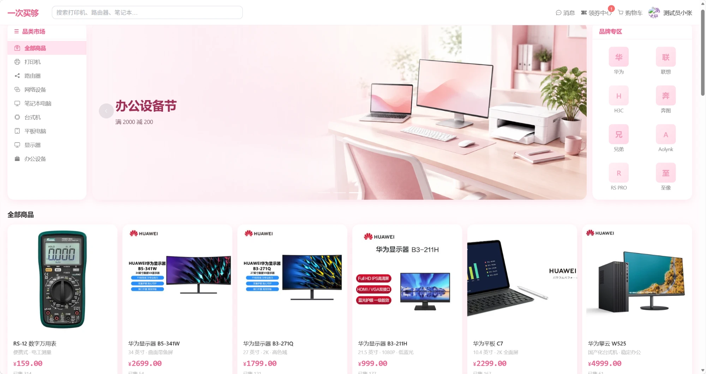
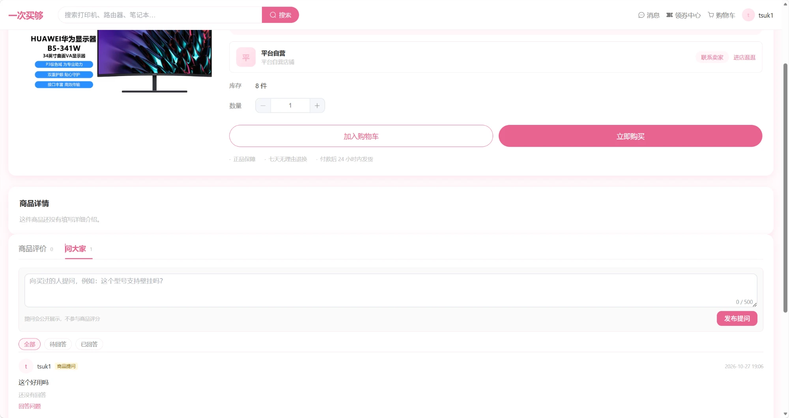
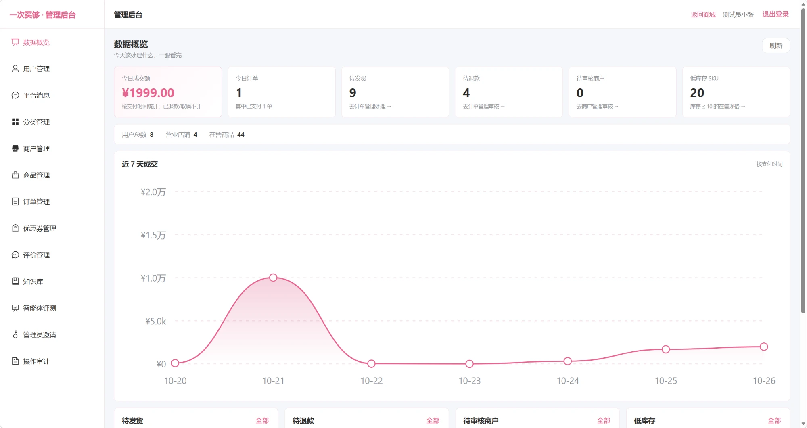
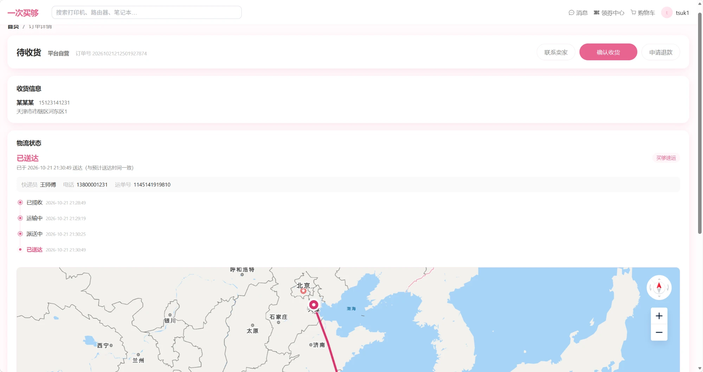

# 一次买够（ItsMyGo）

[](https://github.com/Tsuki11111/ItsMyGo/actions/workflows/test.yml)
[](LICENSE)
[](https://github.com/Tsuki11111/ItsMyGo/stargazers)
[](https://github.com/Tsuki11111/ItsMyGo/commits/main)


**多商户**网购平台：商家自助入驻、店铺商品、跨店购物车按店拆单分别支付，
平台管理员负责商户审核与全平台监管（**不做佣金 / 分账 / 结算**）。
Spring Boot 单体 + Vue 3 前后端分离，经 **gRPC 接入 RAG 客服智能体**（外部项目 `rag_helper`）。

**定位**：学习练手 / 简历项目，不是真实运营 —— 无真实支付、无高并发要求。

---

## 界面预览

**商城首页（顾客端）**



**商品详情 · 商品评价与问大家**



**管理后台 · 数据概览**



**订单详情与物流轨迹**



---

## 技术栈

| 层 | 选型 |
|---|---|
| 后端 | Spring Boot 4.1.1 · JDK 17 · **Spring MVC** |
| 数据访问 | **MyBatis-Plus** 3.5.17 —— ✅ 已在 Boot 4.1.1 上验证通过 |
| 数据库 | MySQL 8 —— 复用本机共用容器，库名 `its_mygo` |
| 缓存 | Redis 7 —— 复用本机共用容器，key 前缀 `its-mygo:`（**必须带 TTL**） |
| 表结构迁移 | Flyway 12.4.0 —— **须用 `spring-boot-starter-flyway`**，详见 [HANDOFF §5.1](HANDOFF.md) |
| 安全 | Spring Security 7 + JWT（jjwt 0.13.0，HS256，密码 BCrypt）—— ✅ 已接入 |
| 对象存储 | MinIO 8.5.17 —— 复用本机共用容器，bucket `its-mygo-product-images`，✅ 已接商品图上传 |
| 消息队列 | RabbitMQ 4（AMQP + 管理台）—— 超时未支付订单自动取消，✅ 已接 |
| 客服链路 | 原生 `grpc-java` + `protobuf-maven-plugin`（不用 starter，Boot 4 未适配） |
| API 文档 | springdoc-openapi |
| 日志 | SLF4J + Logback；控制台带 traceId/userId，prod 输出 JSON 文件并保留 14 天 |
| 前端 | Vue 3 + Vite + TypeScript + Element Plus + Pinia + Vue Router |
| 构建 | Maven（**单模块**） |

> ⚠️ **Spring Boot 4 的坑不少** —— 自动配置被拆成独立模块（Flyway 要换官方 starter）、
> Jackson 升到 **3**（包名从 `com.fasterxml.jackson` 变成 `tools.jackson`）、
> `AutoConfigureMockMvc` 换了包路径。动手前先读 [HANDOFF §5](HANDOFF.md)。

## 架构

```
浏览器 ──HTTPS──> Java 单体（登录、权限、页面、SSE 转发）
                    │  gRPC（内网，问答链路）
                    ▼
              Agent 服务（rag_helper）· 8003
                    │  HTTP 工具回调（X-Agent-Ticket，内网）
                    └──────────> Java /internal/agent/**
```

需要实时数据时（如查订单），agent 会反向回调 Java 的内部工具接口；
票据由 Java 每次对话签发，只走 gRPC metadata，不进模型上下文。

**三条边界**（来自 `rag_helper` 的规划，本项目不能自行更改）：

1. 浏览器只跟 Java 说话
2. Agent 服务只在内网、只允许本单体访问
3. 知识库导入与智能体评测是 agent 服务的管理端行为，由 Java 管理端代理，浏览器不直连 agent

**对接契约**以 `rag_helper/evolution-plan.md` §5/§6 与 `rag_helper/proto/agent.proto` 为唯一权威。

## 快速启动（Docker）

前置：Docker Desktop。

```bash
./deploy.sh
```

Windows PowerShell 用 `./deploy.ps1`，参数相同。

打开 `http://localhost:8088`。首次会自动生成 `.env`、管理员密码，并导入 44 个演示商品。
停止用 `./deploy.sh down`；想跳过演示数据用 `./deploy.sh up --no-seed`。

联合客服智能体（两个仓库同级）：

```bash
cd ../rag_helper && ./deploy.sh joint
```

端口、环境变量、手工 Compose、镜像源等问题见 [docs/deployment.md](docs/deployment.md)。

## 进度

| 阶段 | 状态 |
|---|---|
| 基础交易闭环 M0–M4：骨架 / 账号 / 商品分类 / 购物车下单 / 支付售后 | ✅ 2026-10-12 ~ 10-16 |
| 顾客端 + 管理端前端 M5 / M5.5：商品 / SKU / 结算 / 订单 / 用户中心 / 后台 | ✅ 2026-10-18 |
| 多商户与在线聊天 M5.6 / M5.7：入驻审核 / 按店拆单 / SSE 会话 | ✅ 2026-10-19 |
| 客服智能体 M6–M13：gRPC 接入 / 查订单物流 / 导购 / 下单退款草稿 / 催发货退款 | ✅ 2026-10-20 ~ 10-23 |
| 运营后台 M15 / M16 / M18 / M19：数据概览 / 订单筛选导出 / 用户审计 / 商户商品运营 | ✅ 2026-10-22 ~ 10-24 |
| 内容与商品体验 M20–M22：品牌专区 / 缩略图 / 知识库导入 | ✅ 2026-10-24 ~ 10-25 |
| 安全与管理员治理 M23 / M24：密码强度 / bootstrap / 邀请审批 | ✅ 2026-10-25 |
| 商户经营看板 M25 + Docker 一键部署与联合启动 | ✅ 2026-10-25 |
| 智能体评测 M26：管理端跑 LLM-as-Judge / 新建用例 / 看报告 / 停止任务 | ✅ 2026-10-26 |
| 商品社区 M27：买家评价评分分布 / 问大家（提问 + 买家回答） | ✅ 2026-10-27 |

**交易闭环**：浏览 → 加购 → 按店拆单 → 支付 → 发货 → 收货；取消 / 超时关单 / 退款都会回滚库存与优惠券。

**核心工程能力**：多规格 SKU、库存防超卖、缓存三防、限流、下单幂等、RabbitMQ 延迟关单、日志 traceId、操作审计。

**AI 客服「买小购」**：Java 经 gRPC 调外部 agent，SSE 回传答案 / 执行流 / 商品卡；支持查订单物流、导购、智能下单与退款草稿、催发货 / 催退款；管理端可导入知识库，并在 `/admin/agent-eval` 运行 LLM-as-Judge 查看接地性报告。

**商品社区**：商品详情分「商品评价 / 问大家」两个 Tab；买家确认收货后可评分评价，支持评分分布和星级筛选；未购买用户可在问大家提问，买过的人回答，问答不计入商品评分。

**测试**：本地 254 条；CI 跳过 4 条依赖 MinIO 的用例，跑 250 条；测试库 / Redis db 与开发隔离。

**下一步**：商户与商品运营二期（商品审核 / 券运营等），可选 M14 导购增强。
详细里程碑与验收记录见 [HANDOFF.md](HANDOFF.md) §6。

## 本地开发

复用本机已有的 `mysql` / `redis` / `minio`：

```bash
./mvnw spring-boot:run
cd frontend && npm run dev     # 另开终端
```

打开 `http://localhost:5173`，演示账号 `testuser` / `123456`。
中间件、RabbitMQ、客服智能体、管理员开通等完整清单见 [start.txt](start.txt)。

## 文档

| 文件 | 作用 |
|---|---|
| [HANDOFF.md](HANDOFF.md) | **本项目一切细节的权威源** —— 具体进度、下一步、踩过的坑 |
| [docs/deployment.md](docs/deployment.md) | **部署细节** —— 端口、环境变量、联合部署、手工 Compose、镜像源 |
| [docs/api.md](docs/api.md) | **后端接口文档** —— 全部接口、请求/响应、权限、限流与 SSE 事件 |
| [docs/implementation.md](docs/implementation.md) | **代码怎么实现的** —— 请求流转、认证链路、各模块实现要点与取舍 |
| [docs/decisions-ecommerce.md](docs/decisions-ecommerce.md) | 需求分析与选型决策的完整理由、分阶段路线 |
| [CLAUDE.md](CLAUDE.md) | 给 AI 助手的项目约定与协作偏好 |

> 本 README 是 [HANDOFF.md](HANDOFF.md) 的**精简报告**。
> 两者内容允许重复（一个详细、一个简洁），**如有出入一律以 HANDOFF 为准**。
