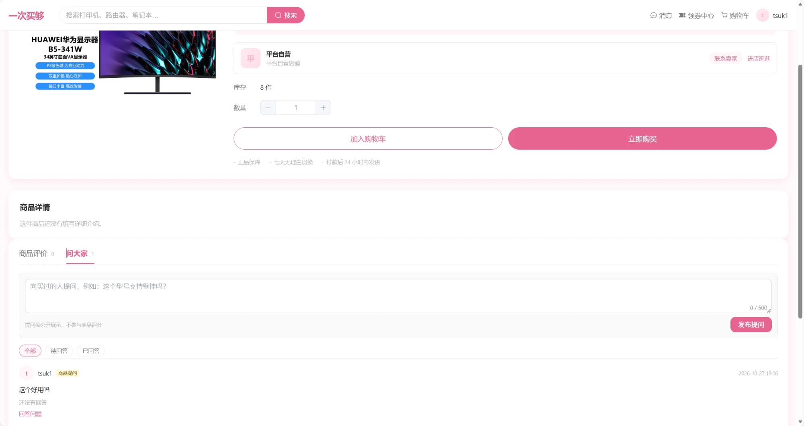
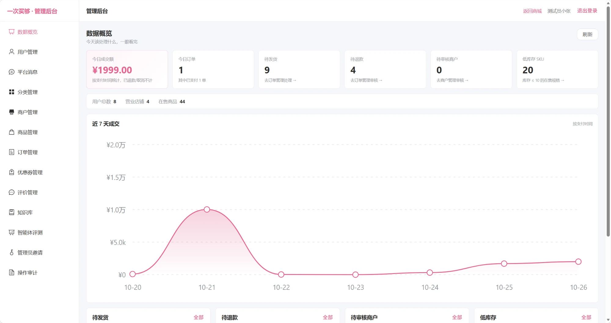
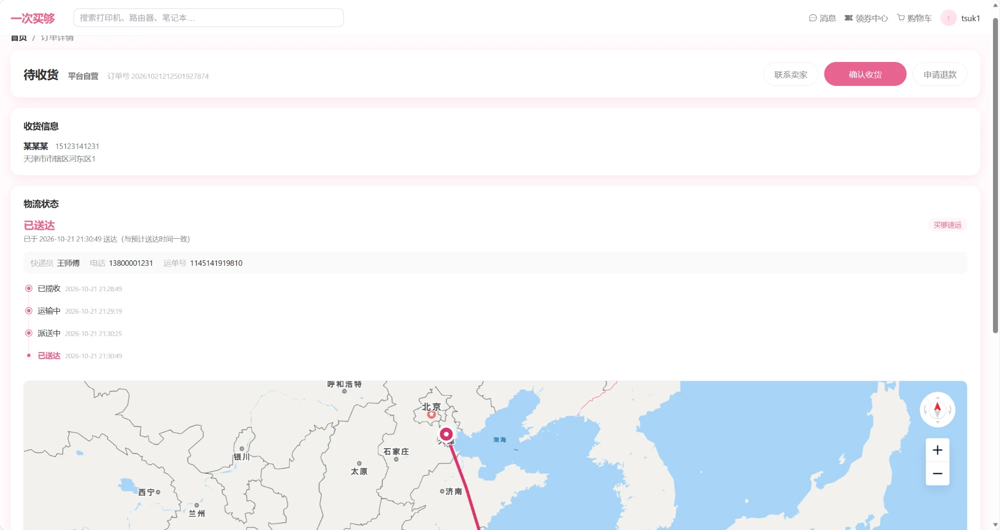

# 一次买够（ItsMyGo）

[](https://github.com/Tsuki11111/ItsMyGo/actions/workflows/test.yml)
[](LICENSE)
[](https://github.com/Tsuki11111/ItsMyGo/stargazers)
[](https://github.com/Tsuki11111/ItsMyGo/commits/main)


**多商户**网购平台：商家自助入驻、店铺商品、跨店购物车按店拆单分别支付，
平台管理员负责商户审核与全平台监管（**不做佣金 / 分账 / 结算**）。
Spring Boot 单体 + Vue 3 前后端分离，经 **gRPC 接入 RAG 客服智能体**（外部项目 `rag_helper`）。

**定位**：学习练手 / 简历项目，不是真实运营 —— 无真实支付；但**按高并发标准做**
（用户 2026-10-15 要求，缓存 / 并发 / 一致性不因「没流量」降要求，清单见 [HANDOFF §5 末尾](HANDOFF.md)）。

---

## 界面预览

**商城首页（顾客端）**


**商品详情 · 商品评价与问大家**



**管理后台 · 数据概览**



**订单详情与物流轨迹**



---

## 技术栈

| 层 | 选型 |
|---|---|
| 后端 | Spring Boot 4.1.1 · JDK 17 · **Spring MVC** |
| 数据访问 | **MyBatis-Plus** 3.5.17 —— ✅ 已在 Boot 4.1.1 上验证通过 |
| 数据库 | MySQL 8 —— 复用本机共用容器，库名 `its_mygo` |
| 缓存 | Redis 7 —— 复用本机共用容器，key 前缀 `its-my-go:`（**必须带 TTL**） |
| 表结构迁移 | Flyway 12.4.0 —— **须用 `spring-boot-starter-flyway`**，详见 [HANDOFF §5.1](HANDOFF.md) |
| 安全 | Spring Security 7.1 + JWT（jjwt 0.13.0，HS256，密码 BCrypt）—— ✅ 已接入 |
| 对象存储 | MinIO 8.5.17 —— 复用本机共用容器，bucket `its-my-go-product-images`，✅ 已接商品图上传 |
| 消息队列 | RabbitMQ 4（AMQP + 管理台）—— 超时未支付订单自动取消，✅ 已接 |
| 客服链路 | 原生 `grpc-java` + `protobuf-maven-plugin`（不用 starter，Boot 4 未适配） |
| API 文档 | **未集成 springdoc**；接口清单见手写的 [docs/api.md](docs/api.md) |
| 日志 | SLF4J + Logback；控制台带 traceId/userId，prod 输出 JSON 文件并保留 14 天 |
| 前端 | Vue 3 + Vite + TypeScript + Element Plus + Pinia + Vue Router |
| 构建 | Maven（**单模块**） |

> ⚠️ **Spring Boot 4 的坑不少** —— 自动配置被拆成独立模块（Flyway 要换官方 starter）、
> Jackson 升到 **3**（包名从 `com.fasterxml.jackson` 变成 `tools.jackson`）、
> `AutoConfigureMockMvc` 换了包路径。动手前先读 [HANDOFF §5](HANDOFF.md)。

## 架构

```
浏览器 ──HTTPS──> Java 单体（登录、权限、页面、SSE 转发）
                    │  gRPC（内网，问答链路）
                    ▼
              Agent 服务（rag_helper）· 8003
                    │  HTTP 工具回调（X-Agent-Ticket，内网）
                    └──────────> Java /internal/agent/**
```

需要实时数据时（如查订单），agent 会反向回调 Java 的内部工具接口；
票据由 Java 每次对话签发，只走 gRPC metadata，不进模型上下文。

**三条边界**（来自 `rag_helper` 的规划，本项目不能自行更改）：

1. 浏览器只跟 Java 说话
2. Agent 服务只在内网、只允许本单体访问
3. 知识库导入与智能体评测是 agent 服务的管理端行为，由 Java 管理端代理，浏览器不直连 agent

**对接契约**：字段以 `rag_helper/proto/agent.proto` 为**唯一权威**；说明性概览见
`rag_helper/docs/architecture.md` §4，对接前提见 `rag_helper/docs/requirements.md` §4
（rag_helper 2026-11-05 文档归并后，原 `evolution-plan.md` §5/§6 已迁到这两个位置，旧文件已删除）。

## 环境分层（先看这个）

| 环境 | 怎么起 | 数据 | 入口 |
|---|---|---|---|
| **开发环境** | `dev-infra/`（只起中间件）+ 本机 `mvnw` / `vite` / rag_helper venv | 共享 MySQL `its_mygo`、`rag_helper-*` 卷 | 前端 `5173`、后端 `8080` |
| **演示环境**（本地全栈） | `./deploy.sh` / `npm run deploy`（根 `docker-compose.yml`） | `its-my-go-*` 独立卷 | `http://localhost:8088` |
| **生产环境**（内网 VM） | VM 离线包：同款根 compose + `docker-compose.offline.yml` + 预构建镜像；一键 `~/itsmygo-offline/start.sh`（=`install.sh`，幂等） | VM 上的 `its-my-go-*` 卷 | `http://10.184.171.106:8088` |

三者数据与端口互相隔离，**不能同时起**（开发与演示抢 3306/6379/9000/5672）。
根 `docker-compose.yml` 是演示与生产共用的编排，日常开发请用 `dev-infra/`。

## 快速启动（Docker · 演示环境）

前置：Docker Desktop。

```bash
./deploy.sh          # macOS / Linux / Git Bash
./deploy.ps1         # Windows PowerShell
npm run deploy       # 任意平台（需要 Node ≥18；只是转发到上面两个脚本）
```

打开 `http://localhost:8088`。首次会自动生成 `.env`、管理员密码，并导入 44 个演示商品。
停止用 `./deploy.sh down`（或 `npm run deploy -- down`）；想跳过演示数据用
`./deploy.sh up --no-seed`（或 `npm run deploy -- up --no-seed`）。
npm 入口的完整命令见 [docs/deployment.md](docs/deployment.md#命令)。

联合客服智能体（两个仓库都可在本机任意位置，用 `.rag-helper-dir` 或 `RAG_HELPER_DIR` 指定）：

```bash
./deploy.sh joint          # 演示环境联合启动（ItsMyGo + rag_helper）
npm run deploy:joint       # 同上的 npm 入口
```
Windows 用 `.\deploy.ps1 joint`。停止两套：`./deploy.sh joint-down`。
开发环境（本机进程）联合启动用 `npm run dev:joint`（见「本地开发」）。

> 联合入口已收归本仓库；`rag_helper/deploy.sh joint` 现在只是转发到这里。

端口、环境变量、手工 Compose、镜像源等问题见 [docs/deployment.md](docs/deployment.md)。

## 进度

| 阶段 | 状态 |
|---|---|
| 基础交易闭环 M0–M4：骨架 / 账号 / 商品分类 / 购物车下单 / 支付售后 | ✅ 2026-10-12 ~ 10-16 |
| 顾客端 + 管理端前端 M5 / M5.5：商品 / SKU / 结算 / 订单 / 用户中心 / 后台 | ✅ 2026-10-18 |
| 多商户与在线聊天 M5.6 / M5.7：入驻审核 / 按店拆单 / SSE 会话 | ✅ 2026-10-19 |
| 客服智能体 M6–M13：gRPC 接入 / 查订单物流 / 导购 / 下单退款草稿 / 催发货退款 | ✅ 2026-10-20 ~ 10-23 |
| 运营后台 M15 / M16 / M18 / M19：数据概览 / 订单筛选导出 / 用户审计 / 商户商品运营 | ✅ 2026-10-22 ~ 10-24 |
| 内容与商品体验 M20–M22：品牌专区 / 缩略图 / 知识库导入 | ✅ 2026-10-24 ~ 10-25 |
| 安全与管理员治理 M23 / M24：密码强度 / bootstrap / 邀请审批 | ✅ 2026-10-25 |
| 商户经营看板 M25 + Docker 一键部署与联合启动 | ✅ 2026-10-25 |
| 智能体评测 M26：管理端跑 LLM-as-Judge / 新建用例 / 看报告 / 停止任务 | ✅ 2026-10-26 |
| 商品社区 M27：买家评价评分分布 / 问大家（提问 + 买家回答） | ✅ 2026-10-27 |
| 压力测试 M28：读接口 QPS 基线 / 并发下单不超卖 / 支付幂等 | ✅ 2026-11-02 |
| 平台政策 M29：用户协议 / 隐私政策 / 退换货政策 / 商家规范 | ✅ 2026-11-03 |
| 售后 M30：售后单 / 退货退款 / 部分退款 / 原因字典 / 超时自动处理 | ✅ 2026-11-05 |
| 下单异步补账 M31：占位订单 + MQ 补账 + 扫描兜底（D1） | ✅ 2026-11-06 |

**交易闭环**：浏览 → 加购 → 按店拆单 → 支付 → 发货 → 收货；取消 / 超时关单 / 退款都会回滚库存与优惠券。

**核心工程能力**：多规格 SKU、库存防超卖、缓存三防、限流、下单幂等、RabbitMQ 延迟关单、**下单异步补账（占位单 + MQ + 扫描兜底）**、**售后单（部分退款 / 退货退款 / 超时自动处理）**、日志 traceId、操作审计。

**AI 客服「买小购」**：Java 经 gRPC 调外部 agent，SSE 回传答案 / 执行流 / 商品卡；支持查订单物流、导购、智能下单与退款草稿、催发货 / 催退款；管理端可导入知识库，并在 `/admin/agent-eval` 运行 LLM-as-Judge 查看接地性报告。

**商品社区**：商品详情分「商品评价 / 问大家」两个 Tab；买家确认收货后可评分评价，支持评分分布和星级筛选；未购买用户可在问大家提问，买过的人回答，问答不计入商品评分。

**平台政策**：用户协议、隐私政策、退换货与售后政策、商家入驻与经营规范；正式文本在 [docs/policies/](docs/policies/)，顾客端页脚与注册页可直达，内容与代码实际行为一致（模拟支付、不支持换货、无自助注销等）。

**测试**：本地 274 条（`npm test` 或 `./mvnw test`）；CI 跳过 4 条依赖 MinIO 的用例，跑 270 条；测试库 / Redis db 与开发隔离。

**压力测试**（2026-11-02，本机同机）：商品列表 / 详情 2600–3500 QPS，分类 / 令牌 / 布隆过滤器 7000+ QPS，全程零失败、Full GC 0 次；10 并发抢 5 件库存恰好 5 单成功（不超卖）；同一订单 5 并发支付只产生 1 条支付记录。基线与复现方法见 [HANDOFF §4.8](HANDOFF.md)。

**下一步**：商户与商品运营二期（商品审核 / 券运营等），可选 M14 导购增强。
详细里程碑与验收记录见 [HANDOFF.md](HANDOFF.md) §6。

## 本地开发

本地基础设施（ItsMyGo + rag_helper 共用）统一收在仓库内的 **`dev-infra/`** 目录
（一个 compose 项目，Docker Desktop 只显示一个 `dev-infra` 分组）；容器名、端口、数据卷与以前一致：

```bash
cd dev-infra
docker compose --env-file .env up -d      # mysql/redis/minio/mongo/milvus/neo4j/rabbitmq/...
docker compose --env-file .env ps        # 查看状态
docker compose --env-file .env down      # 停止（external 数据卷不会删）
```

> 不要在 ItsMyGo 仓库里跑全量 `docker compose up`：那会再起一套
> `its-my-go-mysql` / `its-my-go-redis` / `its-my-go-minio`（独立数据卷、抢同样端口），
> 造成“两套数据”的错觉（2026-11-07 踩过，见 HANDOFF §5.41/§5.42）。
> 全量 `./deploy.sh` 只在“不用本机开发库”的全栈演示场景使用。

然后起应用（两种方式任选）：

```bash
# 方式 A：一键拉起开发环境（中间件 + ItsMyGo 前后端 + rag_helper 三进程）
npm run dev:joint            # 首次按提示配置 .rag-helper-dir / RAG_HELPER_DIR
npm run dev:joint:status     # 查看状态
npm run dev:joint:stop       # 停止应用进程（中间件保留）

# 方式 B：手动分进程
./mvnw spring-boot:run
cd frontend && npm run dev     # 另开终端
```

也可以在**仓库根**用 npm 转发（零依赖，脚本会自动选平台对应的命令）：

```bash
npm run dev:api                # = ./mvnw spring-boot:run（Windows 自动用 mvnw.cmd）
npm run dev                    # 另开终端，= cd frontend && npm run dev
npm run dev:joint              # 开发环境联合启动（dev-infra + 前后端 + rag_helper venv）
npm run dev:joint:stop         # 停止应用进程
npm run build                  # 前端生产构建 + 后端 jar（跳过测试）
npm run type-check             # 前端 vue-tsc
npm test                       # = ./mvnw test（后端全量）
```

打开 `http://localhost:5173`，演示账号 `testuser` / `123456`。
中间件、RabbitMQ、客服智能体、管理员开通等完整清单见 [start.txt](start.txt)。
根目录 npm 脚本只是转发，真正的命令仍在 `mvnw` / `frontend/package.json` / `deploy.sh`。

## 文档

| 文件 | 作用 |
|---|---|
| [docs/requirements.md](docs/requirements.md) | **需求分析** —— 产品定位、角色与场景、功能 / 非功能需求、平台对接前提、验收标准、范围外、里程碑与待定问题 |
| [docs/architecture.md](docs/architecture.md) | **架构选型** —— 技术栈与理由、总体架构、接口契约概览、关键取舍、决策记录 D1–D15、跨仓库协作 |
| [docs/implementation.md](docs/implementation.md) | **代码怎么实现的** —— 请求流转、认证链路、各模块实现要点与取舍 |
| [HANDOFF.md](HANDOFF.md) | **状态与坑的权威源** —— 具体进度、下一步、踩过的坑、环境与操作 |
| [docs/api.md](docs/api.md) | **后端接口文档** —— 全部接口、请求 / 响应、权限、限流与 SSE 事件 |
| [docs/deployment.md](docs/deployment.md) | **部署细节** —— 端口、环境变量、联合部署、手工 Compose、镜像源、**生产（内网 VM）环境与缺口** |
| [CLAUDE.md](CLAUDE.md) | 给 AI 助手的项目约定与协作偏好 |

> **文档分层**（2026-11-05 归并）：需求看 requirements、选型看 architecture、
> 「怎么做」看 implementation、「现在什么状态 / 哪里有坑」看 HANDOFF、接口看 api、部署看 deployment。
> 原 `docs/decisions-ecommerce.md` 已删除（内容全部并入上面两份，原文可用 `git log` 查）。
>
> 本 README 是 [HANDOFF.md](HANDOFF.md) 的**精简报告**。
> 两者内容允许重复（一个详细、一个简洁），**如有出入一律以 HANDOFF 为准**（需求以 requirements 为准）。
